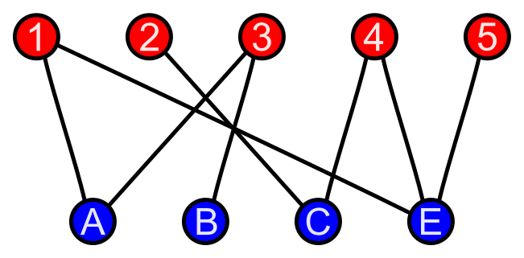
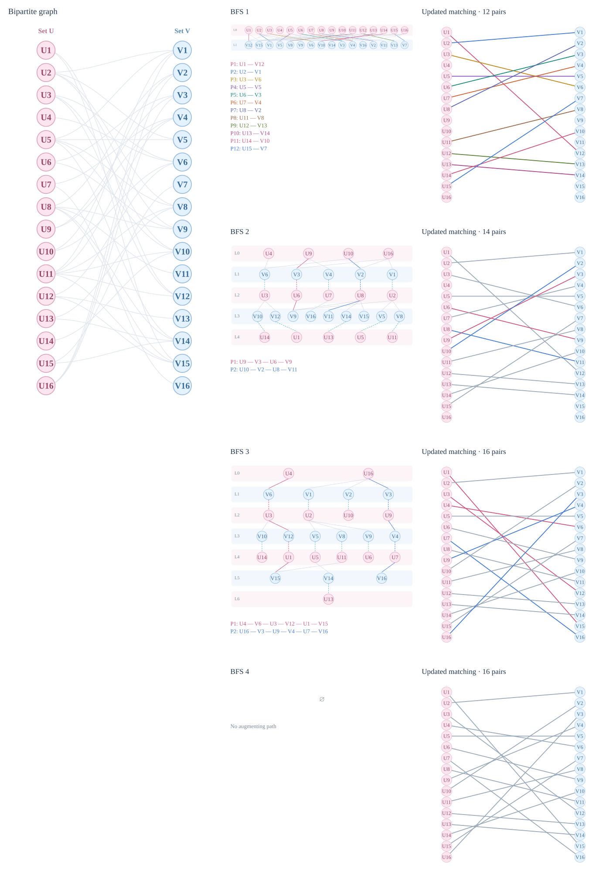
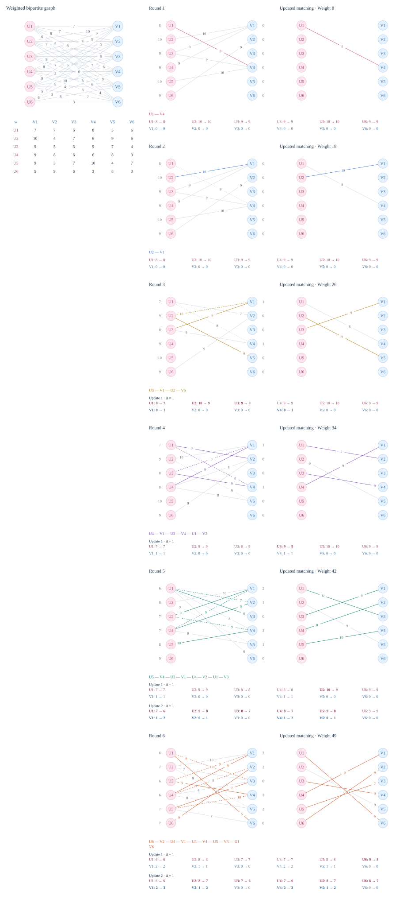

# Bipartite Graph

[TOC]

## Define

> A bipartite graph is a graph whose vertices can be split into two parts so that every edge connects the two parts.

$$
(X, Y, E)  \tag{Bipartite Graph}
$$
$$
X, Y \cap \varnothing, X \cup Y = V  \tag{vertex sets}
$$
$$
E \sube  X \times Y\tag{edge set}
$$

For a Bipartite Graph, The vertex set $V$ of a graph is divided into two disjoint subsets $X, Y$. And, edges in Bipartite Graph only exist between point sets $X, Y$, not within them. The weights of edges can be represented by
$$
f: X\times Y \to S
$$

## Properties

- Representation, a bipartite graph can be represented by a matrix $M \in S^{m \times n}$ with each value $M_{ij}$ refer to the edge weight between $x_i$ and $y_j$, where $m$ is the element number of $X$ and $n$ is that of $Y$.
  $$
  f:(X \times Y) \to S \quad\Longrightarrow\quad S^{m \times n}
  $$

## Bipartite Matching
A matching in a bipartite graph $G=(U,V,E)$ is a set of edges $M \sube E$ such that no two distinct edges in $M$ share an endpoint $e_i\cap e_j=\varnothing (i\neq j)$.

- **Maximum-cardinality bipartite matching**: A maximum matching is a matching  $M \sube E$ with the largest possible number of edges, such that no two selected edges share a vertex.
- **Maximum-weight bipartite matching**: Given an edge weight $w_{uv}\in\mathbb{R}$ for each $(u,v)\in E$, find a matching maximizing the sum of its edge weights $\max_{x}  \sum\limits_{(u,v)\in E} w_{uv}x_{uv}$.
- **Stable bipartite matching**: There does not exist a pair of participants who would both prefer each other over their current matching outcome. It focuses on both parties being willing to pair up with someone else.
- **Capacitated bipartite matching (bipartite $b$-matching)**. Assigning an upper capacity bound $b(v)$ to each vertex $v$, with the requirement that the number of edges incident to a vertex in the matching must not exceed its assigned capacity. The simplest modification is to split the corresponding node into $b(N)$ copies, and then run Maximum Matching.

### Properties

Augmenting Path: (1) Starts and ends at an unmatched nodes. (2) Edges along the path alternate between matched and unmatched states. If no augmenting path can be found in the graph, it means the current solution cannot be further improved and is, therefore, the optimal solution.
$$
\nexists \text{ augmenting path for }M\ \Longleftrightarrow\ M\text{ is a maximum matching}
$$

Therefore, the maximum matching problem is transformed into the problem of how to quickly find augmenting paths.

### Optimal Solutions

#### Maximum-cardinality matching: Hopcroft-Karp Algorithm

The core of the Hopcroft–Karp algorithm lies in simultaneously finding multiple vertex-disjoint shortest augmenting paths in each iteration. 

1. First, a Breadth-First Search (BFS) is initiated from all unmatched vertices on the left side, traversing alternating sequences of "unmatched edges" and "matched edges" to establish a layered structure and determine the shortest distance to any unmatched vertex on the right side.
2. Subsequently, a Depth-First Search (DFS) is employed within this layered graph to identify a maximal set of shortest augmenting paths; the matching status of the edges along each of these paths is then toggled, thereby increasing the total size of the matching.
3. This process is repeated until the BFS can no longer locate any augmenting paths, at which point the maximum matching has been obtained. 

This batch-augmentation approach ensures that the shortest augmenting paths found in subsequent iterations become progressively longer. Time consuming is $O(|E|\sqrt{V})$. However, Hopcroft–Karp maximizes matching size, not weight. Optimizing the total weight requires changing matched edges while keeping the number of matched pairs.

#### Maximum-weight matching: Kuhn-Munkres Algorithm

The core of the KM algorithm lies in assigning labels to each vertex such that the sum of the labels at the endpoints of any edge is at least as large as the weight of that edge. The algorithm searches for augmenting paths exclusively along "tight edges"—edges for which the sum of the endpoint labels equals the edge weight. If no such path can be found, the labels are adjusted to introduce new tight edges, and the search for augmenting paths continues. When a perfect matching is finally obtained, its total weight is exactly equal to the sum of all vertex labels. Since this sum serves as an upper bound on the weight of any perfect matching, the resulting matching is guaranteed to be optimal.

- "Not found" means that, starting from an unmatched vertex on the left side and exploring all possible alternating paths consisting of "tight" edges, one still cannot reach an unmatched vertex on the right side.
- When you get stuck, examine the edges that connect the set of "reached" nodes on the left side to the "unreached" nodes on the right. Identify the edge that is closest to meeting the equality condition, and adjust the labels by the exact difference required. Specifically, decrease the labels of all reached nodes on the left and increase the labels of all reached nodes on the right by the same amount. For edges that have already been traversed, the decrease on one end and the increase on the other cancel each other out, leaving their sum unchanged—so they remain valid. For edges leading to unreached nodes, only the left-side label is decreased, which brings the "closest" edge exactly to the point of equality. Because we choose the smallest difference, no other edge will be adjusted beyond the point of equality. This allows the search to continue without violating the established conditions.

#### Stable bipartite matching: Gale–Shapley

The Gale–Shapley (GS) algorithm is a "propose-and-defer-acceptance": 

1. Unmatched proposers make proposals to acceptors to whom they have not yet proposed, following their respective preference orderings. 
2. Each acceptor retains the proposer they prefer most—comparing the new proposal against any currently held tentative match—and rejects the others; this process continues until no further proposals can be made. 

The resulting matching contains no **blocking pairs** (no pair of vertices $(u, v)$ not matched to each other such that both prefer one another over their current partners). The time complexity is $O(n^2)$ and yields a proposer-optimal stable matching.