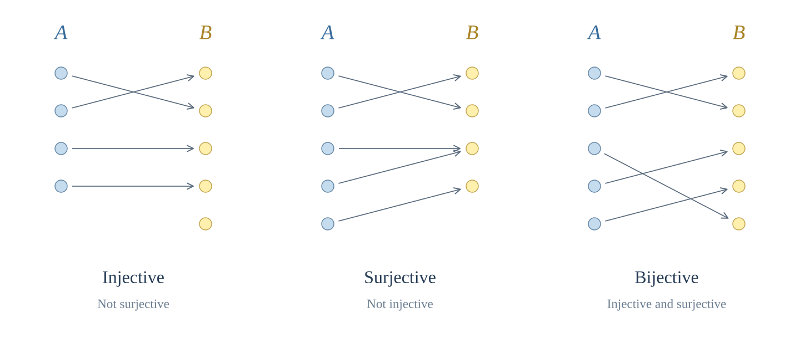

# Function

[TOC]

## Define

> A function assigns each input exactly one output.

$$
f: X \to Y  \tag{Function}
$$
$$
\forall x \in X, \exists_{= 1} y \in Y, f(x) = y
$$
Function, or Mapping, refer to a [binary relation](./Relation.md) from the element of set $X$ to that of set $Y$, and satisfy any element in $X$ has a unique element in $Y$ corresponding to it (One-to-many is not allowed).

$X$: Domain of Definition.

### Injective, Surjection, Bijection

> Injective means no two inputs share an output, surjective means every output is reached, and bijective means both are true.

$$
\forall x, x', f(x) = f(x') \Rightarrow x = x'
$$
Each mapped element $y$ has a unique element $x$ corresponding to it.

$$
\forall y \in Y, \exists x \in X, f(x) = y
$$
Each element $y$ in set $Y$ has a element $x$ in set $X$ corresponding to it.

$$
\forall y \in Y, \exists_{= 1} x \in X, f(x) = y
$$
Bijection, or One-to-One Correspondence, is a map that is both injective and surjective. Each element $y$ in set $Y$ has a unique element $x$ in set $X$ corresponding to it. Meanwhile, each element $x$ in set $X$ has a unique element $y$ in set $Y$ corresponding to it.

## Properties

Inverse Function. if $f$ is a bijection, its inverse function is $f^{-1}(b) = a \Leftrightarrow f(a) = b$

### Convolution

When the relevant integrability conditions hold, the convolution of two functions is
$$
(f * g)(t) = \int_{-\infty}^{\infty} f(\tau) g(t-\tau)\, d\tau.
$$

Convolution is an operation on functions rather than a standalone object node.

Properties,

- convolution in the time domain becomes multiplication in the frequency domain.

$$
f(t)*g(t)\quad \longleftrightarrow\quad F(\omega)G(\omega)
$$

| Function $f(t)$          | Function $g(t)$          | Result $f(t)*g(t)$                             |
| ------------------------ | ------------------------ | ---------------------------------------------- |
| $f(t)$                   | $\delta(t)$              | $f(t)$                                         |
| $f(t)$                   | $\delta(t-t_0)$          | $f(t-t_0)$                                     |
| $\delta(t-t_1)$          | $\delta(t-t_2)$          | $\delta(t-t_1-t_2)$                            |
| $u(t)$                   | $u(t)$                   | $t\,u(t)$                                      |
| $t\,u(t)$                | $u(t)$                   | $\frac{t^2}{2}u(t)$                            |
| $\frac{t^{n}}{n!}u(t)$   | $u(t)$                   | $\frac{t^{n+1}}{(n+1)!}u(t)$                   |
| $e^{-at}u(t)$            | $e^{-bt}u(t)$, $a\neq b$ | $\displaystyle\frac{e^{-at}-e^{-bt}}{b-a}u(t)$ |
| $e^{-at}u(t)$            | $e^{-at}u(t)$            | $t e^{-at}u(t)$                                |
| $\operatorname{rect}(t)$ | $\operatorname{rect}(t)$ | $\operatorname{tri}(t)$                        |
| Gaussian                 | Gaussian                 | Gaussian                                       |
| $f(t)$                   | $g(t)$                   | $g(t)*f(t)$                                    |
| $f*g$                    | $h$                      | $f*(g*h)$                                      |
| $f$                      | $g+h$                    | $f*g+f*h$                                      |

## Hilbert Transform

For a suitable function $u$, the Hilbert transform is the principal-value singular integral
$$
H(u)(t) = \operatorname{p.v.}\frac{1}{\pi} \int_{-\infty}^{\infty} \frac{u(\tau)}{t-\tau}\, d\tau.
$$

## Laplace Transform

For a suitable function $f$, the Laplace transform is
$$
\mathcal L f(s) = \int_0^{\infty} f(t) e^{-st}\, dt.
$$

These transforms are standard operations on functions, so they are stored here instead of as standalone nodes.

## Fourier Transform

$$
\mathcal F f(s) = \int_{-\infty}^{\infty} f(t) e^{-i\omega t}\, dt.
$$

### Important Fourier Transform Properties

| Property           | Time Domain                           | Frequency Domain                                             |
| ------------------ | ------------------------------------- | ------------------------------------------------------------ |
| Linearity          | $ax_1(t)+bx_2(t)$                     | $aX_1(\omega)+bX_2(\omega)$                                  |
| Time shifting      | $x(t-t_0)$                            | $e^{-j\omega t_0}X(\omega)$                                  |
| Frequency shifting | $e^{j\omega_0t}x(t)$                  | $X(\omega-\omega_0)$                                         |
| Time scaling       | $x(at)$                               | $\frac{1}{\|a\|}X(\omega/a)$                                 |
| Time reversal      | $x(-t)$                               | $X(-\omega)$                                                 |
| Differentiation    | $\frac{dx(t)}{dt}$                    | $j\omega X(\omega)$                                          |
| Convolution        | $x(t)*h(t)$                           | $X(\omega)H(\omega)$                                         |
| Multiplication     | $x(t)h(t)$                            | $\frac{1}{2\pi}[X*H](\omega)$                                |
| Parseval's theorem | $\int_{-\infty}^{\infty}\|x(t)\|^2dt$ | $\frac{1}{2\pi}\int_{-\infty}^{\infty}\|X(\omega)\|^2d\omega$ |

### Discrete Fourier Transform

The DFT converts a finite sequence of $N$ samples into $N$ frequency-domain coefficients.
$$
X[k]=\sum_{n=0}^{N-1}x[n]e^{\frac{-j2\pi kn}{N}}
$$

### Fast Fourier Transform

FFT is a computational algorithm that calculates the same DFT result with fewer arithmetic operations. FFT uses the principle of divide and conquer.  Computational complexity is $O(N\log_2 N)$.
$$
X[k]=E[k]+W_N^kO[k] \\

X[k+N/2]=E[k]-W_N^kO[k]
$$
