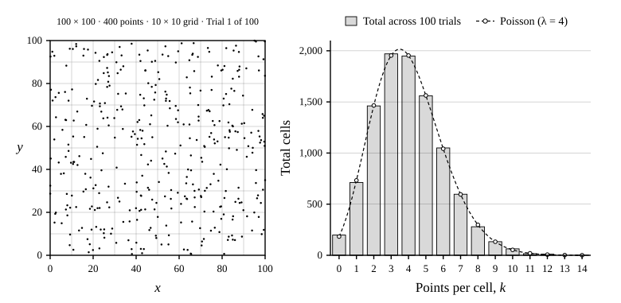

# Poisson Point Process

[TOC]

## Define

> A Poisson point process is a point process with independent increments and constant intensity.

A Poisson point process is a stochastic process that assigns to each measurable region $A$ a random count $N(A)$ such that for the relevant reference measure $\mu$:

- For disjoint measurable regions $A_1, \dots, A_n$, the random variables $N(A_1), \dots, N(A_n)$ are independent;
- There exists an intensity $\lambda > 0$ such that
$$
N(A) \sim \operatorname{Poisson}(\lambda \mu(A))
$$

## Properties

In the spatially homogeneous case,
$$
\mathbb E[N(A)] = \lambda \mu(A).
$$

Poisson point processes model randomly scattered events in time or space.
