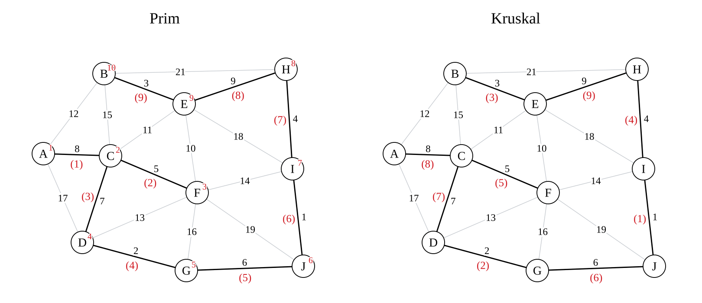

# Tree

[TOC]

## Define

> A tree is a connected acyclic graph.

Tree is a class of connected undirected graphs without loops.

### Rooted Tree

When the root node is set to a certain node of the tree, the hierarchical relationship of the entire tree and the parent-child relationship among each node will be uniquely determined.

- **root node**: A node without forward nodes, and a tree has only one root node.
- **leaf node:** A node that has no children.
- **depth**: Number of edges in the simple path from node to root node. The depth of the tree is the maximum node depth in the tree.

## Properties

- There exists and only exists one single simple path between any two points of the tree.
- $number(E) = number(V) - 1$
- Delete an edge, the Tree will become disconnected;  Add an edge, the Tree will have a loop.

### Minimum Spanning Tree

A minimum spanning tree $T$ is a tree and a subgraph of a finite, connected, undirected weighted graph $G$.

**Prim's Algorithm** starts from any vertex and grows a single tree. At each step, it selects the minimum-weight edge connecting a vertex already in the tree to a vertex outside it, then adds that edge and the new vertex. The process continues until all vertices are included. Its time complexity is **O(E log V)**.

**Kruskal’s algorithm** starts with each vertex as a separate component and considers edges in increasing order of weight. It accepts an edge if it connects two different components and skips it if it would create a cycle. The process stops when $V-1$ edges have been accepted, forming a minimum spanning tree. Its time complexity is **O(E log E)**.

